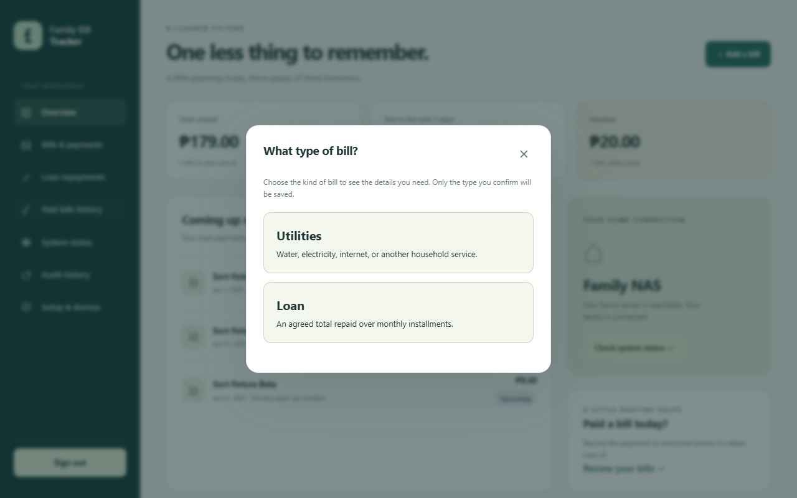
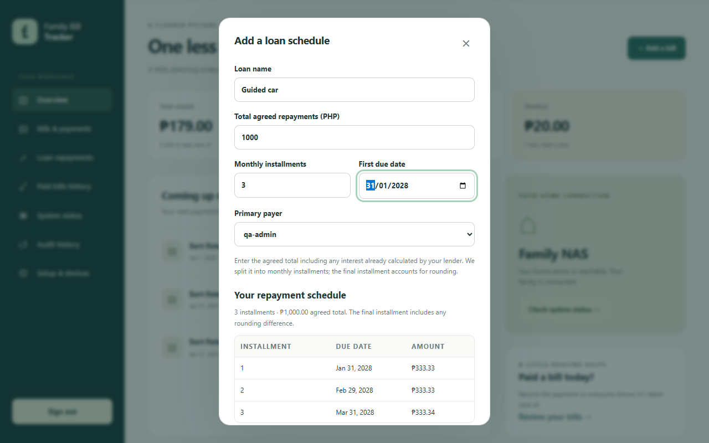
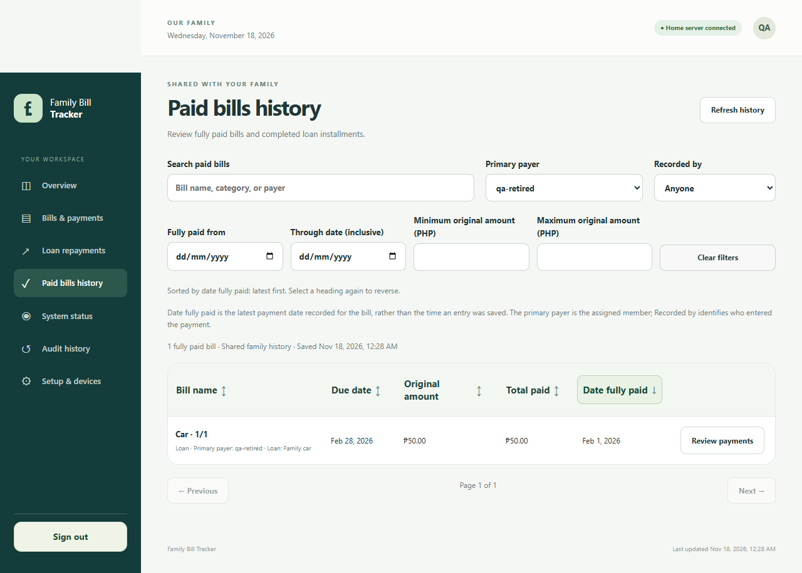
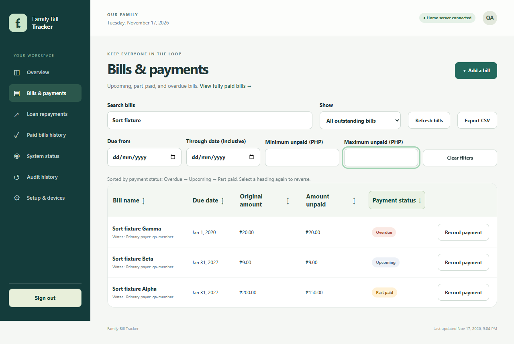
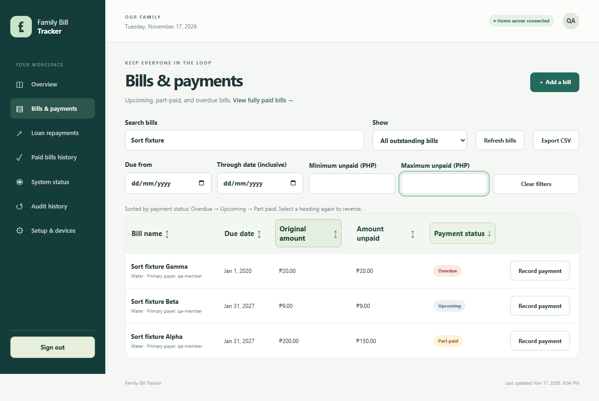

# Adding, reviewing, and finding bills

## Choose a bill type

Add bill from Overview or Bills & payments starts with **Utilities** or **Loan**.

- **Utilities:** enter the service, actual bill amount, due date, registered primary payer, and optional notes. Monthly repeat is off by default. Enable it only for a fixed charge that should repeat at the same amount. For changing water/electricity charges, enter each actual bill separately.
- **Loan:** enter the agreed total repayments (including any interest already calculated by the lender), installment count, first due date, and registered primary payer. A live preview lists every due date and amount. Amounts are split in whole centavos; the final installment includes the rounding remainder. The original due day is restored after shorter months, including leap years.

Change bill type returns to the choice and keeps each draft in its own form. Only the form you review and confirm is submitted; hidden values from the other form are excluded. Starting a new Add bill clears both old drafts. The loan-screen Add loan button opens this same flow with Loan selected. Cancel/close does not save. The separate review screen remains required in the shipped UI before a financial write. Existing server validation, active-payer checks, UUID retries, balance constraints, and atomic audit logging remain in force.

Existing records keep their stored categories. No type migration is applied to earlier bills. A loan is identified by its real loan relationship, rather than a category label. The application records repayments; it does not calculate lender interest or transfer money.

## Sort using bill headings

Bills & payments shows only outstanding bills, with original amount and amount unpaid separately. Fully paid records appear in Paid bills history, preserving their payments and audit records. Select a heading to sort immediately, then select it again to reverse:

| Heading | Initial direction when selecting a different heading | Reverse |
| --- | --- | --- |
| Bill name | A–Z, case-insensitive natural order | Z–A |
| Due date | Earliest | Latest |
| Original amount | Highest | Lowest |
| Amount unpaid | Highest | Lowest |
| Payment status | Part paid → Upcoming → Overdue | Overdue → Upcoming → Part paid |

The initial view is already sorted by earliest due date. Clicking its active Due date heading reverses that order. Equal values use record ID as the tie-breaker. Original amount means that bill's amount, including an individual loan installment rather than the whole parent loan. The outstanding view orders Part paid, Upcoming, and Overdue explicitly. Its status filter has no Paid option; fully paid records are reviewed in history. Larger sentence-case heading buttons show a hover/focus highlight and an active direction indicator.

There is no Bills Sort by dropdown. On phones, labelled sorting buttons appear above the cards and use the same active state and directions. Loan cards retain their separate sort dropdown. Search and date/amount/status filters combine with the selected bill sort, which remains selected through ordinary snapshot refreshes and detail viewing. Clear filters resets the bill view to its initial earliest-first order. All changes are immediate and do not require transaction confirmation.

## Shared paid-bills history

Fully paid bills are excluded from Bills & payments and retained in history. The Overview paid-bill summary is replaced by **Paid bills history**, available to every signed-in family member. It includes only bills with zero remaining balance and recorded payments, including completed loan installments. Part-paid records remain in the existing bill views with their payment details.

History shows the original amount, total recorded payments, due date, and **Date fully paid**. That date is the latest recorded payment date on the bill; it is not the time someone entered the record. Review payments opens individual amounts/dates, their recorders, notes, primary payer, and a parent-loan reference when applicable.

Primary payer and Recorded by are separate filters. A recorder is the person who entered the payment, not necessarily the person who transferred money. Filters use stable user IDs, retaining referenced inactive accounts as choices. Renamed users appear under the current name from the last fetched snapshot; payment attribution is unchanged. Search, inclusive completion-date ranges, and amount/title/date sorts update immediately. History renders 25 records per page, resets to page one when filters change, and keeps a clear empty state.

## Offline, privacy, and upgrade

The same sorting and history operate on an opted-in, timestamped offline snapshot. This remains read-only; reconnect and refresh to obtain newer payments or names. Older saved snapshots can use their recorded names as a fallback for history filters until refreshed. Global administrator audit history remains live-only and is separate from shared paid-bill history.

This change adds payment-recorder IDs to the authenticated snapshot, but introduces no database schema migration and does not change balances or erase records. The service-worker shell advances to v8. Restart the web process after deployment to load the updated template, then refresh the browser. Existing database backup practices still apply.

History pagination limits rendered rows, not the size of the existing all-bills snapshot download. A future server-paginated snapshot strategy may be appropriate for substantially larger households/history datasets.

## Screenshots

All records shown are fictional browser-test fixtures.

