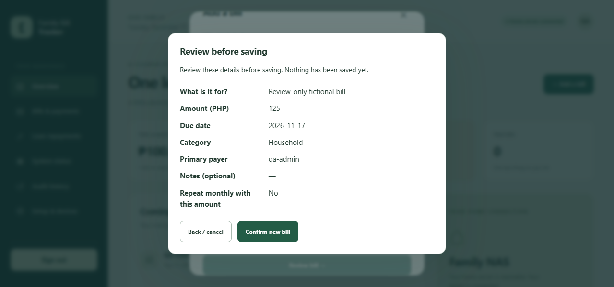
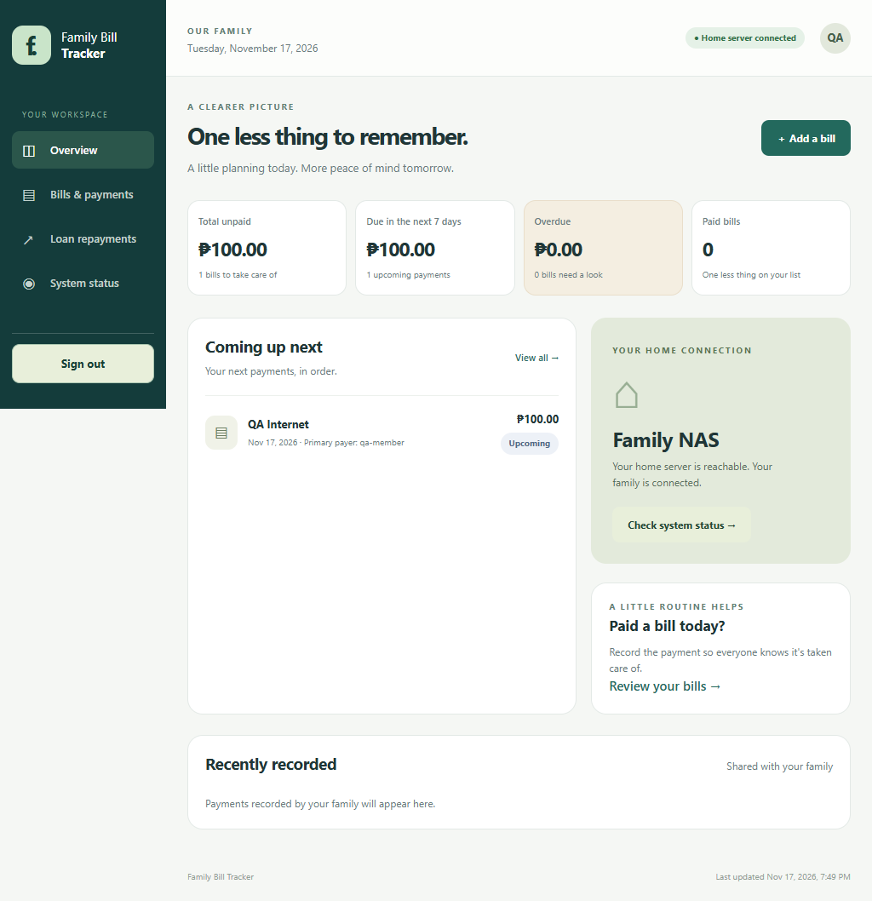
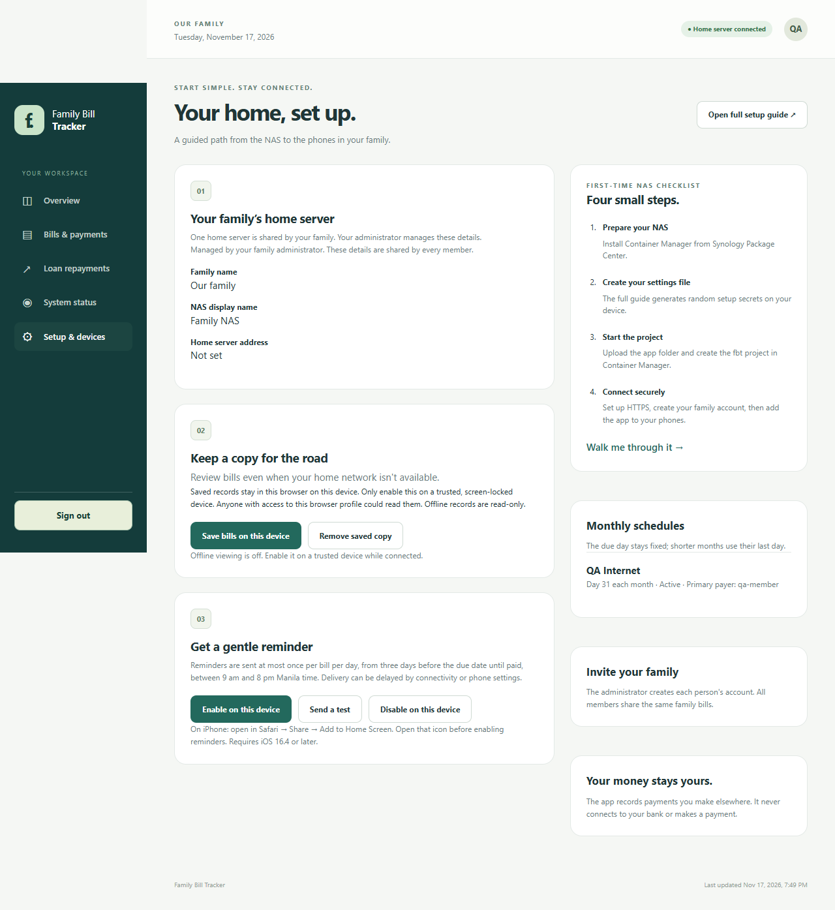

# Family workflows

Implemented in priority order: #9 confirmation, #7 shared server settings, #3 sign-out, #1 monthly schedules, #2 filters, #8 primary payer and account history.

Screenshots use fictional automated-test accounts and bills:

## Review and confirm

Bill and loan creation, payment recording, shared settings, primary-payer changes, and schedule cancellation/removal show a separate review before any business write. Back, Escape, and closing review preserve the draft without saving. Explicit confirmation submits the displayed values. Offline operation remains read-only.

First-family setup, Django account creation/editing, group/permission editing, and account password changes (including your own password page) use the same review dialog. Individual deletion uses Django's protected-object review; bulk deletion is disabled. Passwords and the setup code are redacted. Accounts with financial references must be deactivated, not deleted. Unreferenced accounts may be deleted; their audit history retains the safe identity snapshot. Reassigning a payer does not change the recorded creator or payment recorder, so those relationships can still prevent deletion.

Confirmation is a **UI safeguard**, not a server-enforced two-step authorization protocol. A direct authorized API client can still submit one request. The server independently checks authentication, permissions, CSRF, values, and balances. Existing API clients remain compatible: creation request keys and payment/settings version fields are optional, but the shipped UI always supplies them. New payer/removal/cancellation endpoints require the reviewed record version. Do not describe this as two-factor authentication or as protection against a malicious authorized client.

Bill/payment/payer changes use opaque versions including the current payer and payment state. Workspace edits use a shared settings version. A changed record requires refresh and a new review. Django account, group, deletion and password forms require a signed, actor/path-bound version of their initial record, including memberships, with a 15-minute expiry. This protects against stale edits; it does not prove that a dialog was viewed. Account last-login changes may require reloading an open admin form.

Bill/loan requests from the UI retain a UUID through retries until a draft is edited/reset. A receipt and its business writes commit together, with an actor row lock serializing simultaneous retries. Payment UUIDs retain their existing unique-key protection. If a network timeout leaves the outcome uncertain, reconnect and inspect records/history before starting a fresh transaction. Neither form drafts nor credentials are saved offline.

## Shared home server

One SiteSettings row represents the family. Administrators see its editor; members see a read-only summary. The reachability check detects changed shared settings within approximately 30 seconds and prompts connected members to refresh. Reconnection also requires refresh. An offline snapshot keeps the previous settings and its original timestamp until explicitly updated. The server address is informational: saving it does not change DNS, HTTPS, the app origin, or the physical NAS.

Offline-copy consent and notification subscriptions remain specific to an account/device.

## Sign out

One labelled Sign out button stays pinned in the sidebar on desktop and at the end of the bottom navigation on phones. Navigation scrolls independently so administrator-only links cannot push it out of reach. The upper-right connection indicator is the only connection status in the navigation; the sidebar tagline is removed. Signing out clears the saved snapshot and private dialogs, informs other open tabs, and ends the session. When offline, local records are cleared immediately and a message explains that the server session will be revoked after reconnection and reload.

## Monthly bills and removal

Monthly schedules retain their original day (January 31 → February 28/29 → March 31). Only administrators can cancel or remove schedules or occurrences.

- **Cancel schedule:** stop generation; keep all existing bills, amounts, due dates, and payment history.
- **Remove schedule:** permitted only if none of its bills have payments. Stop generation and mark the schedule and its occurrences removed from active views.
- **Remove one bill:** permitted only without payments and outside loan schedules. Retain the row as a removed occurrence, so worker retries cannot regenerate it. The monthly schedule remains active.

Removal is a retained-record operation, not physical SQL deletion. Removed rows and before/after audit events remain reviewable in Audit history and the read-only database administration. There is no undo control. Bills with payments and loan installments must be retained. Cancellation and removal lock the schedule/bills and commit audit entries atomically; workers recheck schedule state while holding the same schedule lock.

## Filters

Bills filter/sort by **due date** and **unpaid balance**, combined with title/category/payer search and payment status. Loan summaries use **next unpaid installment date** and **remaining balance**, with payer/title search and paid/unpaid status. Date and amount bounds are inclusive; use the same start/end for one exact date. Fully repaid loans have no next due date, sort after dated loans in both directions, and are excluded by date ranges. Equal values sort by record ID. Clear filters resets the view. Bill and loan results update immediately as filters change, including on saved snapshots, without database writes or confirmation. Audit filters reload results automatically after a short typing delay; there is no Apply step.

## Primary payer and account history

Any signed-in member can choose an active registered primary payer when adding a bill or loan. Only administrators can reassign an existing bill. A recurring reassignment explicitly applies to either this bill only or this bill plus **newly generated occurrences**; other already-generated bills remain unchanged. Payment recording attribution never changes. Inactive and missing users are rejected on submission. Deactivated payers remain named on existing financial records, but cannot be selected for new assignments.

Account audit snapshots now include username, first name, last name, email, activation, and role flags; membership changes have separate linked events. Password changes are flagged without storing the credential or hash. Normal direct SQL profile changes remain audited as an unknown database actor. Search can find safe before/after identity details after renaming or permitted deletion. Account data and audit entries roll back together on failure.

## Upgrade and verification

Back up the database and verify restore instructions in OPERATIONS.md. Stop web and worker processes before running migration `0004_family_workflows`, then restart both. The migration preserves all existing rows and audit history, adds lifecycle flags and retry receipts, and replaces audit triggers within the migration transaction. This also handles SQLite table rebuilds. Do not edit the frozen v1/v2 trigger definitions after deployment. Check System status → Audit logging after upgrading. Cached public shells advance to v5 with the new review/filter assets; private snapshots still require a live refresh for new fields.

CI runs PostgreSQL 17 transaction/security/migration checks, JavaScript filter/offline tests and real Chromium workflows on every push/PR, and attaches screenshots as a browser-qa artifact. Browser checks use fictional accounts and an isolated test database; no real family records or local credentials enter the tests. Install the development-only browser dependency with `npm ci` and `npx playwright install chromium`; set `FBT_BROWSER_TESTS=1` when running Django tests to include those checks locally.
